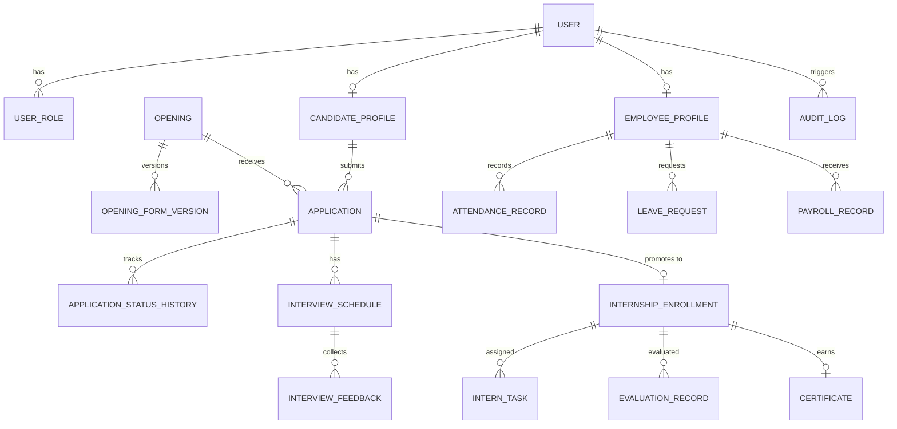
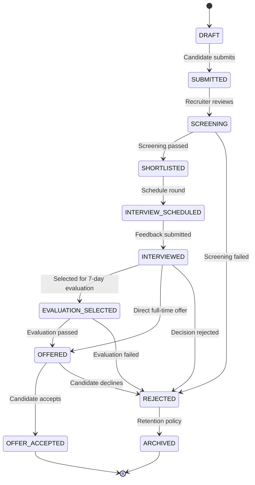

# Data Model & Entity Specifications — GARA Innovation Platform

> **Status:** Architecture outline and entity design specification.
> **Prerequisites:** Prompt 0 stack compatibility audit and Prompt 1 schema initialization.
> **Non-Negotiable Rule:** Attendance, leave, payroll, and evaluation calculation rules are **policy-gated** (see `docs/OPEN_DECISIONS.md`). Schemas define structural storage only; no unapproved calculation formulas are baked into the data model.

---

## 1. Data Architecture Principles

1. **Relational Core (PostgreSQL):** PostgreSQL is the single source of truth. All domain entities use strict relational models with foreign keys, compound indexes, unique constraints, and check constraints.
2. **JSON/JSONB Boundaries:** JSONB is restricted to:
   - Dynamic application form field definitions and candidate submission answers (`versioned_responses`).
   - Audit trail snapshot metadata (`diff / metadata`).
   - Structured configuration options for programme progress monitoring.
   Relational data (users, roles, applications, interviews, certificates, employees) must **never** be flattened into JSON blobs.
3. **Immutability & History:** Status transitions, interview feedbacks, audit entries, and certificate verification events are append-only historical records.
4. **Soft Deletion & Archival:** Candidate records and employee documents utilize explicit archival (`is_archived`, `archived_at`) rather than destructive hard deletes.
5. **UUID Primary Keys:** All public and API-facing identifiers use cryptographically secure random UUIDs (`v4` / `v7`) to eliminate ID enumeration attacks.

---

## 2. High-Level Entity Relationship Diagram

---

## 3. Core Domain Entities

### 3.1 Identity & Access (`src/features/auth`)

#### `User`
Primary account entity for authentication (candidates, staff, mentors, employees, admins).
- `id` (UUID, PK)
- `email` (VARCHAR(255), UNIQUE, NOT NULL)
- `password_hash` (VARCHAR(255), NULLABLE — null for OAuth-only users)
- `name` (VARCHAR(255), NOT NULL)
- `email_verified_at` (TIMESTAMP, NULLABLE)
- `image_url` (VARCHAR(512), NULLABLE)
- `is_active` (BOOLEAN, DEFAULT true)
- `created_at` (TIMESTAMP, DEFAULT NOW())
- `updated_at` (TIMESTAMP, DEFAULT NOW())

#### `Account` (OAuth Linking)
Stores OAuth provider accounts linked to a user.
- `id` (UUID, PK)
- `user_id` (UUID, FK -> `User.id`, ON DELETE CASCADE)
- `provider` (VARCHAR(50), NOT NULL) — e.g., `'google'`
- `provider_account_id` (VARCHAR(255), NOT NULL)
- `access_token` (TEXT, NULLABLE)
- `refresh_token` (TEXT, NULLABLE)
- `expires_at` (TIMESTAMP, NULLABLE)
- `created_at` (TIMESTAMP, DEFAULT NOW())
- Unique constraint: `(provider, provider_account_id)`

#### `UserRole` & `Role`
Role-Based Access Control mapping.
- `id` (UUID, PK)
- `user_id` (UUID, FK -> `User.id`, ON DELETE CASCADE)
- `role` (ENUM: `'CANDIDATE'`, `'INTERN'`, `'EMPLOYEE'`, `'MENTOR'`, `'INTERVIEWER'`, `'HR'`, `'MANAGER'`, `'ADMIN'`)
- `assigned_by` (UUID, FK -> `User.id`, NULLABLE)
- `assigned_at` (TIMESTAMP, DEFAULT NOW())
- Unique constraint: `(user_id, role)`

---

### 3.2 Openings & Dynamic Form Builder (`src/features/openings`, `src/features/application-forms`)

#### `Opening`
Job or internship vacancies.
- `id` (UUID, PK)
- `title` (VARCHAR(255), NOT NULL)
- `slug` (VARCHAR(255), UNIQUE, NOT NULL)
- `department` (VARCHAR(100), NOT NULL)
- `type` (ENUM: `'INTERNSHIP'`, `'FULL_TIME'`)
- `location` (VARCHAR(150), NOT NULL)
- `workplace_type` (ENUM: `'REMOTE'`, `'HYBRID'`, `'ON_SITE'`)
- `description` (TEXT, NOT NULL)
- `requirements` (TEXT, NOT NULL)
- `status` (ENUM: `'DRAFT'`, `'PUBLISHED'`, `'PAUSED'`, `'CLOSED'`)
- `active_form_version_id` (UUID, NULLABLE)
- `created_by` (UUID, FK -> `User.id`)
- `created_at` (TIMESTAMP, DEFAULT NOW())
- `updated_at` (TIMESTAMP, DEFAULT NOW())

#### `OpeningFormVersion`
Immutable, versioned application form definitions. Ensures modifying a form never reinterprets past applications.
- `id` (UUID, PK)
- `opening_id` (UUID, FK -> `Opening.id`, ON DELETE CASCADE)
- `version_number` (INTEGER, NOT NULL)
- `schema_definition` (JSONB, NOT NULL) — Field types, labels, validations, sections, file upload specs
- `is_published` (BOOLEAN, DEFAULT false)
- `created_by` (UUID, FK -> `User.id`)
- `created_at` (TIMESTAMP, DEFAULT NOW())
- Unique constraint: `(opening_id, version_number)`

---

### 3.3 Candidate Applications (`src/features/applications`, `src/features/recruitment`)

#### `CandidateProfile`
Personal information owned by the candidate.
- `id` (UUID, PK)
- `user_id` (UUID, FK -> `User.id`, UNIQUE, ON DELETE CASCADE)
- `phone` (VARCHAR(30), NULLABLE)
- `location` (VARCHAR(150), NULLABLE)
- `current_organization` (VARCHAR(200), NULLABLE)
- `highest_education` (VARCHAR(100), NULLABLE)
- `linkedin_url` (VARCHAR(255), NULLABLE)
- `github_url` (VARCHAR(255), NULLABLE)
- `portfolio_url` (VARCHAR(255), NULLABLE)
- `created_at` (TIMESTAMP, DEFAULT NOW())
- `updated_at` (TIMESTAMP, DEFAULT NOW())

#### `Application`
Application submitted for a specific opening.
- `id` (UUID, PK)
- `reference_code` (VARCHAR(32), UNIQUE, NOT NULL) — e.g., `'GARA-2026-APP-0042'`
- `opening_id` (UUID, FK -> `Opening.id`, RESTRICT)
- `candidate_id` (UUID, FK -> `CandidateProfile.id`, RESTRICT)
- `form_version_id` (UUID, FK -> `OpeningFormVersion.id`, RESTRICT)
- `status` (ENUM: `'DRAFT'`, `'SUBMITTED'`, `'SCREENING'`, `'SHORTLISTED'`, `'INTERVIEW_SCHEDULED'`, `'INTERVIEWED'`, `'EVALUATION_SELECTED'`, `'OFFERED'`, `'OFFER_ACCEPTED'`, `'REJECTED'`, `'WITHDRAWN'`, `'ARCHIVED'`)
- `submitted_responses` (JSONB, NOT NULL) — Immutable snapshot of user's form answers
- `resume_storage_key` (VARCHAR(512), NOT NULL) — Private storage key (not public URL)
- `is_archived` (BOOLEAN, DEFAULT false)
- `archived_at` (TIMESTAMP, NULLABLE)
- `created_at` (TIMESTAMP, DEFAULT NOW())
- `updated_at` (TIMESTAMP, DEFAULT NOW())

#### `ApplicationStatusHistory`
Audit record of every status transition in the hiring pipeline.
- `id` (UUID, PK)
- `application_id` (UUID, FK -> `Application.id`, ON DELETE CASCADE)
- `from_status` (VARCHAR(50), NOT NULL)
- `to_status` (VARCHAR(50), NOT NULL)
- `actor_id` (UUID, FK -> `User.id`)
- `internal_notes` (TEXT, NULLABLE) — Private notes visible only to staff
- `candidate_message` (TEXT, NULLABLE) — Public notification sent to candidate
- `created_at` (TIMESTAMP, DEFAULT NOW())

---

### 3.4 Interviews & Evaluations (`src/features/interviews`, `src/features/internship-evaluation`)

#### `InterviewSchedule`
- `id` (UUID, PK)
- `application_id` (UUID, FK -> `Application.id`, ON DELETE CASCADE)
- `round_number` (INTEGER, NOT NULL)
- `round_name` (VARCHAR(100), NOT NULL) — e.g., `'Technical Assessment'`, `'System Design'`
- `scheduled_at` (TIMESTAMP WITH TIME ZONE, NOT NULL)
- `meeting_link` (VARCHAR(512), NULLABLE)
- `status` (ENUM: `'SCHEDULED'`, `'COMPLETED'`, `'CANCELLED'`, `'RESCHEDULED'`)
- `scheduled_by` (UUID, FK -> `User.id`)
- `created_at` (TIMESTAMP, DEFAULT NOW())
- `updated_at` (TIMESTAMP, DEFAULT NOW())

#### `InterviewFeedback`
- `id` (UUID, PK)
- `schedule_id` (UUID, FK -> `InterviewSchedule.id`, ON DELETE CASCADE)
- `interviewer_id` (UUID, FK -> `User.id`)
- `ratings` (JSONB, NOT NULL) — Scorecards per configured criterion
- `recommendation` (ENUM: `'STRONG_HIRE'`, `'HIRE'`, `'HOLD'`, `'NO_HIRE'`)
- `summary_notes` (TEXT, NOT NULL) — Confidential
- `submitted_at` (TIMESTAMP, DEFAULT NOW())

#### `InternshipEnrollment` *(POLICY-GATED: OD-001, OD-002, OD-003)*
- Tracks candidate entry into the 7-working-day supervised evaluation period.
- `id` (UUID, PK)
- `application_id` (UUID, FK -> `Application.id`, UNIQUE)
- `user_id` (UUID, FK -> `User.id`)
- `supervisor_id` (UUID, FK -> `User.id`, NULLABLE)
- `start_date` (TIMESTAMP, NULLABLE — Triggered via manual start action per OD-001)
- `end_date` (TIMESTAMP, NULLABLE — Target end date computed via WorkingDayService per OD-002)
- `working_days_target` (INTEGER, DEFAULT 7)
- `status` (ENUM: `'PENDING_TRIGGER'`, `'IN_PROGRESS'`, `'UNDER_REVIEW'`, `'PASSED'`, `'FAILED'`, `'EXTENDED'`)
- `checkpoint_config` (JSONB, NULLABLE — Configurable milestone definitions per OD-004)
- `final_review_notes` (TEXT, NULLABLE — Evaluator/Supervisor decision rationale)
- `evaluated_by_id` (UUID, FK -> `User.id`, NULLABLE)
- `evaluated_at` (TIMESTAMP, NULLABLE)
- `created_at` (TIMESTAMP, DEFAULT NOW())
- `updated_at` (TIMESTAMP, DEFAULT NOW())

#### `EvaluationCheckpoint`
- Captures Day 1 through Day 7 progress, intern submissions, and supervisor reviews.
- `id` (UUID, PK)
- `enrollment_id` (UUID, FK -> `InternshipEnrollment.id`, ON DELETE CASCADE)
- `day_number` (INTEGER, 1 to 7)
- `title` (VARCHAR(255), NOT NULL)
- `description` (TEXT, NULLABLE)
- `submission_notes` (TEXT, NULLABLE — Intern notes/deliverables)
- `supervisor_feedback` (TEXT, NULLABLE — Supervisor feedback/ratings)
- `status` (ENUM: `'PENDING'`, `'SUBMITTED'`, `'REVIEWED'`, `'BLOCKED'`)
- `reviewed_by_id` (UUID, FK -> `User.id`, NULLABLE)
- `reviewed_at` (TIMESTAMP, NULLABLE)
- Unique constraint: `(enrollment_id, day_number)`

#### `InternOnboarding` *(POLICY-GATED: OD-014)*
- Triggered strictly upon evaluation `PASSED`. Manages required intern onboarding items.
- `id` (UUID, PK)
- `enrollment_id` (UUID, FK -> `InternshipEnrollment.id`, UNIQUE, ON DELETE CASCADE)
- `user_id` (UUID, FK -> `User.id`)
- `checklist_items` (JSONB, NOT NULL — List of onboarding check items with completion/verification states)
- `status` (ENUM: `'PENDING'`, `'IN_PROGRESS'`, `'COMPLETED'`)
- `completed_at` (TIMESTAMP, NULLABLE)

#### `InternIdCard` *(POLICY-GATED: OD-014)*
- Gated ID card issuance record; strictly requires evaluation `PASSED` + onboarding `COMPLETED` + `ADMIN`/`HR` role.
- `id` (UUID, PK)
- `enrollment_id` (UUID, FK -> `InternshipEnrollment.id`, UNIQUE, ON DELETE CASCADE)
- `user_id` (UUID, FK -> `User.id`)
- `card_number` (VARCHAR(64), UNIQUE, NULLABLE — Format pending OD-014 approval)
- `status` (ENUM: `'PENDING_APPROVAL'`, `'APPROVED'`, `'ISSUED'`, `'REVOKED'`)
- `approved_by_id` (UUID, FK -> `User.id`, NULLABLE)
- `approved_at` (TIMESTAMP, NULLABLE)
- `issued_at` (TIMESTAMP, NULLABLE)
- `metadata` (JSONB, NULLABLE)

---

### 3.5 Internship Tasks, Progress & Certificates (`src/features/intern-tasks`, `src/features/certificates`)

#### `InternTask`
- Work deliverables assigned to the intern by supervisor or HR/admin.
- `id` (UUID, PK)
- `enrollment_id` (UUID, FK -> `InternshipEnrollment.id`, ON DELETE CASCADE)
- `title` (VARCHAR(255), NOT NULL)
- `description` (TEXT, NOT NULL)
- `priority` (ENUM: `'LOW'`, `'MEDIUM'`, `'HIGH'`, `'URGENT'`)
- `due_date` (TIMESTAMP, NULLABLE)
- `status` (ENUM: `'ASSIGNED'`, `'IN_PROGRESS'`, `'SUBMITTED'`, `'REVISION_REQUESTED'`, `'COMPLETED'`, `'BLOCKED'`)
- `assigned_by_id` (UUID, FK -> `User.id`)
- `change_request_notes` (TEXT, NULLABLE — Supervisor feedback when revisions are requested)
- `created_at` (TIMESTAMP, DEFAULT NOW())
- `updated_at` (TIMESTAMP, DEFAULT NOW())

#### `TaskSubmission`
- Append-only submission history for tasks. Preserves all versions, notes, deliverable URLs, and feedback.
- `id` (UUID, PK)
- `task_id` (UUID, FK -> `InternTask.id`, ON DELETE CASCADE)
- `version_number` (INTEGER, 1, 2, 3...)
- `submission_notes` (TEXT, NOT NULL)
- `deliverable_urls` (JSONB, NULLABLE)
- `status` (ENUM: `'PENDING'`, `'APPROVED'`, `'REVISION_REQUESTED'`)
- `supervisor_feedback` (TEXT, NULLABLE)
- `reviewed_by_id` (UUID, FK -> `User.id`, NULLABLE)
- `reviewed_at` (TIMESTAMP, NULLABLE)
- `submitted_at` (TIMESTAMP, DEFAULT NOW())

#### `ProgressReport`
- Periodic check-ins and milestone reports submitted by the intern.
- `id` (UUID, PK)
- `enrollment_id` (UUID, FK -> `InternshipEnrollment.id`, ON DELETE CASCADE)
- `cadence` (ENUM: `'WEEKLY'`, `'BIWEEKLY'`, `'MILESTONE'`, `'CHECKPOINT'`)
- `period_identifier` (VARCHAR(100), NOT NULL — e.g. `'Week 1'`, `'Milestone 1'`)
- `summary` (TEXT, NOT NULL)
- `learnings` (TEXT, NULLABLE)
- `blockers` (TEXT, NULLABLE)
- `supervisor_feedback` (TEXT, NULLABLE)
- `submitted_at` (TIMESTAMP, DEFAULT NOW())
- `reviewed_at` (TIMESTAMP, NULLABLE)

#### `InternCompletion` *(POLICY-GATED: OD-008, OD-009)*
- Verified completion milestone record required prior to certificate issuance.
- `id` (UUID, PK)
- `enrollment_id` (UUID, FK -> `InternshipEnrollment.id`, UNIQUE, ON DELETE CASCADE)
- `status` (ENUM: `'IN_PROGRESS'`, `'PENDING_REVIEW'`, `'APPROVED'`, `'REJECTED'`)
- `checklist_responses` (JSONB, NOT NULL)
- `is_eligible_for_certificate` (BOOLEAN, DEFAULT false)
- `completion_notes` (TEXT, NULLABLE)
- `approved_by_id` (UUID, FK -> `User.id`, NULLABLE)
- `approved_at` (TIMESTAMP, NULLABLE)
- `created_at` (TIMESTAMP, DEFAULT NOW())
- `updated_at` (TIMESTAMP, DEFAULT NOW())

#### `Certificate` *(POLICY-GATED: OD-008, OD-009, OD-010)*
- Immutable certificate issuance record with cryptographic verification ID and QR verification target.
- `id` (UUID, PK)
- `verification_code` (VARCHAR(64), UNIQUE, NOT NULL) — e.g., `'GARA-CERT-2026-X9B27'`
- `enrollment_id` (UUID, FK -> `InternshipEnrollment.id`, UNIQUE — Enforces idempotency)
- `recipient_name` (VARCHAR(255), NOT NULL)
- `programme_title` (VARCHAR(255), NOT NULL)
- `issue_date` (TIMESTAMP, NOT NULL)
- `completion_date` (TIMESTAMP, NOT NULL)
- `signatory_title` (VARCHAR(150), NOT NULL)
- `signatory_name` (VARCHAR(150), NOT NULL)
- `pdf_storage_key` (VARCHAR(512), NULLABLE)
- `qr_payload_url` (VARCHAR(512), NOT NULL) — Target public verification URL
- `status` (ENUM: `'ACTIVE'`, `'REVOKED'`, `'SUPERSEDED'`)
- `revocation_reason` (TEXT, NULLABLE)
- `version_number` (INTEGER, DEFAULT 1)
- `issued_by_id` (UUID, FK -> `User.id`, NULLABLE)
- `created_at` (TIMESTAMP, DEFAULT NOW())
- `updated_at` (TIMESTAMP, DEFAULT NOW())

#### `CertificateReissueHistory`
- Immutable audit log of certificate corrections and reissues.
- `id` (UUID, PK)
- `certificate_id` (UUID, FK -> `Certificate.id`, ON DELETE CASCADE)
- `previous_code` (VARCHAR(64), NOT NULL)
- `new_code` (VARCHAR(64), NOT NULL)
- `reason` (TEXT, NOT NULL)
- `requested_by_id` (UUID, FK -> `User.id`)
- `created_at` (TIMESTAMP, DEFAULT NOW())

#### `CertificateVerificationLog`
- Public audit log tracking every query to `/verify/[code]`.
- `id` (UUID, PK)
- `certificate_id` (UUID, FK -> `Certificate.id`, ON DELETE CASCADE)
- `queried_at` (TIMESTAMP, DEFAULT NOW())
- `ip_hash` (VARCHAR(64), NOT NULL) — Anonymized/hashed IP for abuse detection
- `user_agent` (VARCHAR(255), NULLABLE)

---

### 3.6 Full-Time Recruitment & Employee Core (`src/features/employees`, Prompt 7)

#### `JobOffer`
- Independent full-time employment offer tracking. Rejects unapproved salary/statutory formulas (OD-007 / OD-008).
- `id` (UUID, PK)
- `application_id` (UUID, FK -> `Application.id`, UNIQUE, ON DELETE CASCADE)
- `status` (ENUM: `'DRAFT'`, `'EXTENDED'`, `'ACCEPTED'`, `'DECLINED'`, `'EXPIRED'`, `'REVOKED'`)
- `expected_joining_date` (TIMESTAMP, NOT NULL)
- `department` (VARCHAR(100), NOT NULL)
- `designation` (VARCHAR(100), NOT NULL)
- `location` (VARCHAR(100), NULLABLE)
- `terms_summary` (TEXT, NOT NULL — Agreed role terms and notice period, without statutory salary breakdown)
- `extended_by_id` (UUID, FK -> `User.id`, NULLABLE)
- `extended_at` (TIMESTAMP, NULLABLE)
- `decision_at` (TIMESTAMP, NULLABLE)
- `decline_reason` (TEXT, NULLABLE)
- `notes` (TEXT, NULLABLE — Confidential internal notes)
- `created_at` (TIMESTAMP, DEFAULT NOW())
- `updated_at` (TIMESTAMP, DEFAULT NOW())

#### `Employee`
- Official employee entity. Gated creation strictly requires application status `OFFER_ACCEPTED` and `ADMIN` or `HR` role.
- `id` (UUID, PK)
- `user_id` (UUID, FK -> `User.id`, UNIQUE)
- `employee_code` (VARCHAR(50), UNIQUE, NOT NULL) — e.g. `'GARA-EMP-001'`
- `department` (VARCHAR(100), NOT NULL)
- `designation` (VARCHAR(100), NOT NULL)
- `joining_date` (TIMESTAMP, NOT NULL)
- `status` (ENUM: `'PROBATION'`, `'ACTIVE'`, `'ON_LEAVE'`, `'EXITED'`)
- `manager_id` (UUID, FK -> `Employee.id`, NULLABLE — Self-relation for reporting line hierarchy)
- `personal_phone` (VARCHAR(30), NULLABLE — CONFIDENTIAL: Admin, HR, and self only)
- `emergency_contact` (JSONB, NULLABLE — CONFIDENTIAL: `{ name, relation, phone }`)
- `internal_notes` (TEXT, NULLABLE — CONFIDENTIAL: Admin & HR staff only)
- `application_id` (UUID, FK -> `Application.id`, UNIQUE, NULLABLE — Originating application)
- `onboarding_checklist` (JSONB, NULLABLE — Array of checklist items)
- `created_at` (TIMESTAMP, DEFAULT NOW())
- `updated_at` (TIMESTAMP, DEFAULT NOW())

#### `EmploymentHistory`
- Immutable audit log of promotions, transfers, status transitions, and manager assignments.
- `id` (UUID, PK)
- `employee_id` (UUID, FK -> `Employee.id`, ON DELETE CASCADE)
- `change_type` (VARCHAR(50), NOT NULL — e.g. `'HIRED'`, `'STATUS_CHANGE'`, `'MANAGER_CHANGE'`)
- `previous_value` (VARCHAR(255), NULLABLE)
- `new_value` (VARCHAR(255), NOT NULL)
- `effective_date` (TIMESTAMP, DEFAULT NOW())
- `remarks` (TEXT, NULLABLE)
- `changed_by_id` (UUID, FK -> `User.id`, NULLABLE)
- `created_at` (TIMESTAMP, DEFAULT NOW())

#### `EmployeeDocument`
- Metadata for employee private records (never stored in public directories).
- `id` (UUID, PK)
- `employee_id` (UUID, FK -> `Employee.id`, ON DELETE CASCADE)
- `document_type` (VARCHAR(50), NOT NULL — e.g. `'GOVERNMENT_ID'`, `'DEGREE_CERTIFICATE'`, `'OFFER_LETTER'`)
- `title` (VARCHAR(255), NOT NULL)
- `storage_key` (VARCHAR(512), NOT NULL — Private storage key)
- `mime_type` (VARCHAR(100), NOT NULL)
- `file_size_bytes` (INTEGER, NOT NULL)
- `is_confidential` (BOOLEAN, DEFAULT TRUE)
- `uploaded_by_id` (UUID, FK -> `User.id`)
- `uploaded_at` (TIMESTAMP, DEFAULT NOW())

#### `EmployeeExitRecord`
- Official offboarding clearance record.
- `id` (UUID, PK)
- `employee_id` (UUID, FK -> `Employee.id`, UNIQUE, ON DELETE CASCADE)
- `resignation_date` (TIMESTAMP, NULLABLE)
- `last_working_date` (TIMESTAMP, NOT NULL)
- `reason` (TEXT, NULLABLE)
- `clearance_checklist` (JSONB, NULLABLE)
- `exit_interview_notes` (TEXT, NULLABLE — Staff restricted)
- `status` (VARCHAR(50), DEFAULT `'CLEARED'`)
- `processed_by_id` (UUID, FK -> `User.id`, NULLABLE)
- `created_at` (TIMESTAMP, DEFAULT NOW())
- `updated_at` (TIMESTAMP, DEFAULT NOW())

---

### 3.7 HRMS Modules *(POLICY-GATED: OD-005, OD-006, OD-007)*

> **Architectural Note:** Attendance, leave balances, and payroll calculations are reserved for Prompt 8 and blocked until policies are approved.

#### `AttendanceRecord` *(POLICY-GATED: OD-006)*
- `id` (UUID, PK)
- `employee_id` (UUID, FK -> `Employee.id`, ON DELETE CASCADE)
- `date` (DATE, NOT NULL)
- `clock_in_at` (TIMESTAMP WITH TIME ZONE, NULLABLE)
- `clock_out_at` (TIMESTAMP WITH TIME ZONE, NULLABLE)
- `status` (VARCHAR(50), NOT NULL) — e.g., `'PRESENT'`, `'ABSENT'`, `'HALF_DAY'`, `'ON_LEAVE'`
- `source` (VARCHAR(50), DEFAULT `'WEB_PORTAL'`)
- `notes` (TEXT, NULLABLE)
- Unique constraint: `(employee_id, date)`

#### `LeaveRequest` *(POLICY-GATED: OD-007)*
- `id` (UUID, PK)
- `employee_id` (UUID, FK -> `Employee.id`, ON DELETE CASCADE)
- `leave_type` (VARCHAR(50), NOT NULL) — e.g., `'CASUAL'`, `'SICK'`, `'EARNED'`
- `start_date` (DATE, NOT NULL)
- `end_date` (DATE, NOT NULL)
- `days_count` (DECIMAL(4,1), NOT NULL)
- `status` (ENUM: `'PENDING'`, `'APPROVED'`, `'REJECTED'`, `'CANCELLED'`)
- `reason` (TEXT, NOT NULL)
- `approved_by` (UUID, FK -> `Employee.id`, NULLABLE)
- `reviewed_at` (TIMESTAMP, NULLABLE)
- `created_at` (TIMESTAMP, DEFAULT NOW())

#### `PayrollRecord` *(POLICY-GATED: OD-008)*
- `id` (UUID, PK)
- `employee_id` (UUID, FK -> `Employee.id`, ON DELETE RESTRICT)
- `pay_period_start` (DATE, NOT NULL)
- `pay_period_end` (DATE, NOT NULL)
- `gross_amount` (DECIMAL(12,2), NOT NULL)
- `net_amount` (DECIMAL(12,2), NOT NULL)
- `components_breakdown` (JSONB, NOT NULL) — Basic, HRA, Allowances, Deductions (structures pending D-12)
- `payslip_storage_key` (VARCHAR(512), NULLABLE)
- `status` (ENUM: `'DRAFT'`, `'APPROVED'`, `'PROCESSED'`, `'PAID'`)
- `processed_by` (UUID, FK -> `User.id`, NULLABLE)
- `processed_at` (TIMESTAMP, NULLABLE)
- Unique constraint: `(employee_id, pay_period_start, pay_period_end)`

---

### 3.7 Platform Cross-Cutting Entities

#### `AuditLog`
Comprehensive system audit ledger.
- `id` (UUID, PK)
- `actor_id` (UUID, FK -> `User.id`, NULLABLE — null for unauthenticated events)
- `actor_role` (VARCHAR(50), NULLABLE)
- `action` (VARCHAR(100), NOT NULL) — e.g., `'APPLICATION_SHORTLISTED'`, `'CERTIFICATE_REVOKED'`
- `resource_type` (VARCHAR(50), NOT NULL) — e.g., `'application'`, `'employee'`
- `resource_id` (VARCHAR(64), NOT NULL)
- `diff_payload` (JSONB, NULLABLE) — Changeset snapshot
- `ip_address` (VARCHAR(45), NULLABLE)
- `created_at` (TIMESTAMP, DEFAULT NOW())

#### `NotificationOutbox`
Durable outbox pattern for asynchronous email delivery via Nodemailer.
- `id` (UUID, PK)
- `recipient_email` (VARCHAR(255), NOT NULL)
- `template_name` (VARCHAR(100), NOT NULL)
- `payload` (JSONB, NOT NULL)
- `status` (ENUM: `'PENDING'`, `'PROCESSING'`, `'SENT'`, `'FAILED'`)
- `attempts` (INTEGER, DEFAULT 0)
- `max_attempts` (INTEGER, DEFAULT 5)
- `last_error` (TEXT, NULLABLE)
- `sent_at` (TIMESTAMP, NULLABLE)
- `created_at` (TIMESTAMP, DEFAULT NOW())

---

## 4. State Machines & Enums

### Application Lifecycle State Machine

---

## 5. Migration Strategy & Rules

1. **Versioned Migrations Only:** All database evolution happens through forward-only versioned Prisma migrations in `prisma/migrations/`.
2. **Never Edit Applied Migrations:** Historical migration files are strictly read-only.
3. **Additive First:** When modifying schemas in live environments, make changes backwards-compatible (e.g., add new column with default, migrate data, then deprecate old column).
4. **Seed Segregation:** `prisma/seed.ts` is strictly for deterministic local test fixtures. Production migration runs must never execute test seeds.
