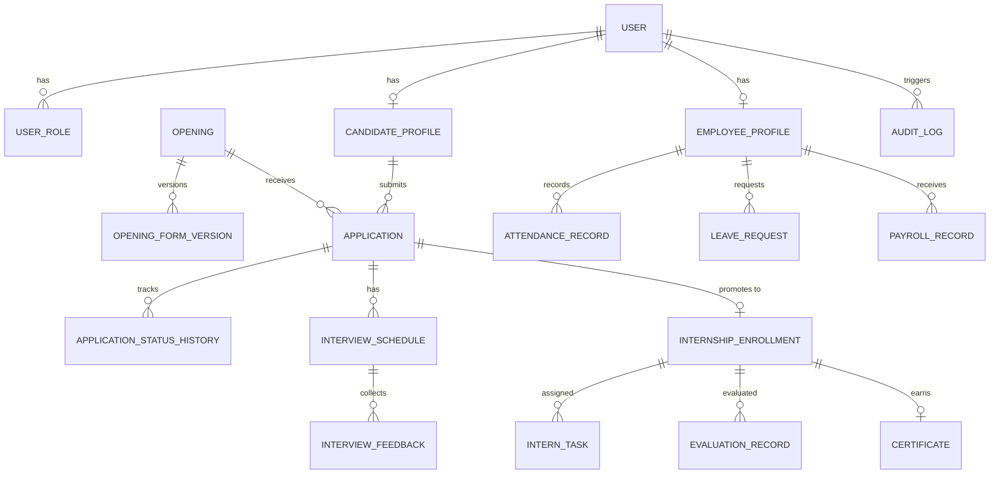
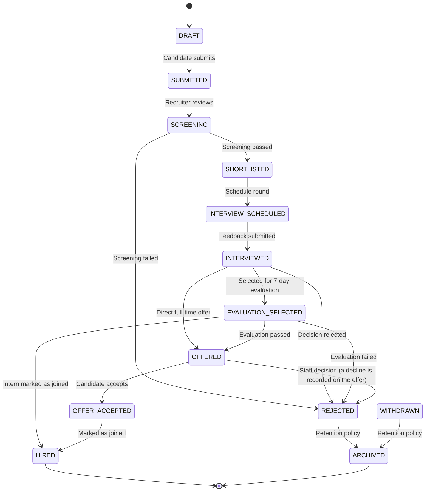

# Data Model & Entity Specifications — GARA Innovation Platform

> **Status:** Architecture outline and entity design specification.
> **Source of truth:** `prisma/schema.prisma` and the versioned migrations in `prisma/migrations/`. The field lists below are the design outline (snake_case, simplified types); where they differ from the schema, the schema wins.
> **Non-Negotiable Rule:** Attendance, leave, payroll, and evaluation calculation rules are **policy-gated** (see `docs/OPEN_DECISIONS.md`). Schemas define structural storage only; no unapproved calculation formulas are baked into the data model.

---

## 1. Data Architecture Principles

1. **Relational Core (PostgreSQL):** PostgreSQL is the single source of truth. All domain entities use strict relational models with foreign keys, compound indexes, unique constraints, and check constraints.
2. **JSON/JSONB Boundaries:** JSONB is restricted to:
   - Dynamic application form field definitions and candidate submission answers (`versioned_responses`).
   - Audit trail snapshot metadata (`diff / metadata`).
   - Structured configuration options for programme progress monitoring.
   Relational data (users, roles, applications, interviews, certificates, employees) must **never** be flattened into JSON blobs.
3. **Immutability & History:** Status transitions, interview feedbacks, audit entries, and certificate verification events are append-only historical records.
4. **Soft Deletion & Archival:** Candidate records and employee documents utilize explicit archival (`is_archived`, `archived_at`) rather than destructive hard deletes.
5. **UUID Primary Keys:** All public and API-facing identifiers use cryptographically secure random UUIDs (`v4` / `v7`) to eliminate ID enumeration attacks.

---

## 2. High-Level Entity Relationship Diagram

---

## 3. Core Domain Entities

### 3.1 Identity & Access (`src/lib/auth`, `src/features/auth`)

#### `User`
Primary account entity for authentication (candidates, staff, mentors, employees, admins).
- `id` (UUID, PK)
- `email` (VARCHAR(255), UNIQUE, NOT NULL)
- `password_hash` (VARCHAR(255), NULLABLE — null for OAuth-only users)
- `name` (VARCHAR(255), NOT NULL)
- `email_verified_at` (TIMESTAMP, NULLABLE)
- `image_url` (VARCHAR(512), NULLABLE)
- `is_active` (BOOLEAN, DEFAULT true)
- `created_at` (TIMESTAMP, DEFAULT NOW())
- `updated_at` (TIMESTAMP, DEFAULT NOW())

#### `Account` (OAuth Linking)
Stores OAuth provider accounts linked to a user.
- `id` (UUID, PK)
- `user_id` (UUID, FK -> `User.id`, ON DELETE CASCADE)
- `provider` (VARCHAR(50), NOT NULL) — e.g., `'google'`
- `provider_account_id` (VARCHAR(255), NOT NULL)
- `access_token` (TEXT, NULLABLE)
- `refresh_token` (TEXT, NULLABLE)
- `expires_at` (TIMESTAMP, NULLABLE)
- `created_at` (TIMESTAMP, DEFAULT NOW())
- Unique constraint: `(provider, provider_account_id)`

#### `UserRole` & `Role`
Role-Based Access Control mapping.
- `id` (UUID, PK)
- `user_id` (UUID, FK -> `User.id`, ON DELETE CASCADE)
- `role` (ENUM: `'CANDIDATE'`, `'INTERN'`, `'EMPLOYEE'`, `'MENTOR'`, `'INTERVIEWER'`, `'HR'`, `'MANAGER'`, `'ADMIN'`)
- `assigned_by` (UUID, FK -> `User.id`, NULLABLE)
- `assigned_at` (TIMESTAMP, DEFAULT NOW())
- Unique constraint: `(user_id, role)`

---

### 3.2 Openings & Dynamic Form Builder (`src/features/openings`, `src/features/application-forms`)

#### `Opening`
Job or internship vacancies.
- `id` (UUID, PK)
- `title` (VARCHAR(255), NOT NULL)
- `slug` (VARCHAR(255), UNIQUE, NOT NULL)
- `department` (VARCHAR(100), NOT NULL)
- `type` (ENUM: `'INTERNSHIP'`, `'FULL_TIME'`)
- `location` (VARCHAR(150), NOT NULL)
- `workplace_type` (ENUM: `'REMOTE'`, `'HYBRID'`, `'ON_SITE'`)
- `description` (TEXT, NOT NULL)
- `requirements` (TEXT, NOT NULL)
- `status` (ENUM: `'DRAFT'`, `'PUBLISHED'`, `'PAUSED'`, `'CLOSED'`)
- `active_form_version_id` (UUID, NULLABLE)
- Listing details (2026-11-19, all optional): `track_id` (FK -> `Track.id`, ON DELETE SET NULL), `summary`, `skills` (TEXT[], default empty), `eligibility`, `duration_text`, `stipend_policy_text`, `openings_count` (INTEGER, CHECK NULL or > 0), `apply_deadline` (TIMESTAMP: the end of the chosen last day in the business time zone; after it the opening is hidden from listings and refuses applications)
- `created_by` (UUID, FK -> `User.id`)
- `created_at` (TIMESTAMP, DEFAULT NOW())
- `updated_at` (TIMESTAMP, DEFAULT NOW())
- Indexes: `(status)`, `(track_id)`, `(status, apply_deadline)`; the slug `tracks` is reserved (route `/careers/tracks/{slug}`)

#### `Track` (2026-11-19)
Staff-managed career tracks that group openings; each has a page at `/careers/tracks/{slug}`.
- `id` (UUID, PK), `slug` (UNIQUE), `name`, `description` (NULLABLE), `sort_order` (INTEGER, default 0), `is_active` (BOOLEAN, default true; hidden tracks keep their openings but leave the filters, pages and sitemap)
- Seeded by the migration with the five tracks of the product owner's plan: `software`, `full-stack`, `ui-ux`, `ai-ml`, `cloud-backend`

#### `OpeningFormVersion`
Immutable, versioned application form definitions. Ensures modifying a form never reinterprets past applications.
- `id` (UUID, PK)
- `opening_id` (UUID, FK -> `Opening.id`, ON DELETE CASCADE)
- `version_number` (INTEGER, NOT NULL)
- `schema_definition` (JSONB, NOT NULL) — Field types, labels, validations, sections, file upload specs
- `is_published` (BOOLEAN, DEFAULT false)
- `created_by` (UUID, FK -> `User.id`)
- `created_at` (TIMESTAMP, DEFAULT NOW())
- Unique constraint: `(opening_id, version_number)`

---

### 3.3 Candidate Applications (`src/features/applications`, `src/features/recruitment`)

#### `CandidateProfile`
Personal information owned by the candidate.
- `id` (UUID, PK)
- `user_id` (UUID, FK -> `User.id`, UNIQUE, ON DELETE CASCADE)
- `phone` (VARCHAR(30), NULLABLE)
- `location` (VARCHAR(150), NULLABLE)
- `current_organization` (VARCHAR(200), NULLABLE)
- `highest_education` (VARCHAR(100), NULLABLE)
- `linkedin_url` (VARCHAR(255), NULLABLE)
- `github_url` (VARCHAR(255), NULLABLE)
- `portfolio_url` (VARCHAR(255), NULLABLE)
- Education (2026-11-19, from the apply form): `college_id` (FK -> `College.id`, ON DELETE SET NULL), `branch`, `year_of_study` (INTEGER, CHECK 1–6), `graduation_year` (INTEGER, CHECK 1950–2100)
- `created_at` (TIMESTAMP, DEFAULT NOW())
- `updated_at` (TIMESTAMP, DEFAULT NOW())

#### `College` (2026-11-19)
College master list for the apply form.
- `id` (UUID, PK), `name`, `normalized_name` (UNIQUE: lower case, letters/digits/& only, so one row per college name), `city`, `state` (NULLABLE)
- `status` (ENUM `CollegeStatus`: `'APPROVED'`, `'PENDING'`) — a college typed by a student is PENDING and is suggested only to that student until staff approve it (`/admin/colleges`)
- `created_by` (FK -> `User.id`, ON DELETE SET NULL)

#### `Application`
Application submitted for a specific opening.
- `id` (UUID, PK)
- `reference_code` (VARCHAR(32), UNIQUE, NOT NULL) — e.g., `'GARA-2026-APP-0042'`
- `opening_id` (UUID, FK -> `Opening.id`, RESTRICT)
- `candidate_id` (UUID, FK -> `CandidateProfile.id`, RESTRICT)
- `form_version_id` (UUID, FK -> `OpeningFormVersion.id`, RESTRICT)
- `status` (ENUM: `'DRAFT'`, `'SUBMITTED'`, `'SCREENING'`, `'SHORTLISTED'`, `'INTERVIEW_SCHEDULED'`, `'INTERVIEWED'`, `'EVALUATION_SELECTED'`, `'OFFERED'`, `'OFFER_ACCEPTED'`, `'REJECTED'`, `'WITHDRAWN'`, `'ARCHIVED'`)
- `submitted_responses` (JSONB, NOT NULL) — Immutable snapshot of user's form answers
- `resume_storage_key` (VARCHAR(512), NOT NULL) — Private storage key (not public URL)
- `resume_url` (TEXT, NULLABLE) — https share link when `DOCUMENT_STORAGE_MODE=link` (2026-10-25)
- `source` (TEXT, NULLABLE, indexed) — Normalised application source code (e.g. `LINKEDIN`, `CAREERS_PAGE`, `OTHER`); 2026-10-25
- `source_detail` (TEXT, NULLABLE) — Plain-text campaign detail (utm values, referrer host), max 200 characters
- `consent_at`, `consent_version` (NULLABLE; 2026-11-19) — when the candidate accepted the Privacy Policy and Terms on the apply form, and which policy version (`LEGAL.version` in `src/config/site.ts`)
- Unique constraint: `(opening_id, candidate_id)` — one application per candidate per opening, ever (product owner, 2026-11-19)
- `is_archived` (BOOLEAN, DEFAULT false)
- `archived_at` (TIMESTAMP, NULLABLE)
- `created_at` (TIMESTAMP, DEFAULT NOW())
- `updated_at` (TIMESTAMP, DEFAULT NOW())

#### `ApplicationStatusHistory`
Audit record of every status transition in the hiring pipeline.
- `id` (UUID, PK)
- `application_id` (UUID, FK -> `Application.id`, ON DELETE CASCADE)
- `from_status` (VARCHAR(50), NOT NULL)
- `to_status` (VARCHAR(50), NOT NULL)
- `actor_id` (UUID, FK -> `User.id`)
- `internal_notes` (TEXT, NULLABLE) — Private notes visible only to staff
- `candidate_message` (TEXT, NULLABLE) — Public notification sent to candidate
- `created_at` (TIMESTAMP, DEFAULT NOW())

---

### 3.4 Interviews & Evaluations (`src/features/recruitment`, `src/features/internship-evaluation`)

#### `InterviewSchedule`
- `id` (UUID, PK)
- `application_id` (UUID, FK -> `Application.id`, ON DELETE CASCADE)
- `round_number` (INTEGER, NOT NULL)
- `round_name` (VARCHAR(100), NOT NULL) — e.g., `'Technical Assessment'`, `'System Design'`
- `scheduled_at` (TIMESTAMP WITH TIME ZONE, NOT NULL)
- `meeting_link` (VARCHAR(512), NULLABLE)
- `status` (ENUM: `'SCHEDULED'`, `'COMPLETED'`, `'CANCELLED'`, `'RESCHEDULED'`)
- `scheduled_by` (UUID, FK -> `User.id`)
- `ics_sequence` (INTEGER, DEFAULT 0) — iCalendar `SEQUENCE`; incremented on every reschedule and on cancel (2026-10-25)
- `created_at` (TIMESTAMP, DEFAULT NOW())
- `updated_at` (TIMESTAMP, DEFAULT NOW())

#### `InterviewBookingRequest` (2026-10-25)
Slots offered to a candidate to choose an interview time.
- `id` (UUID, PK)
- `application_id` (UUID, FK -> `Application.id`, ON DELETE CASCADE)
- `round_number` (INTEGER), `round_name` (TEXT), `duration_minutes` (INTEGER)
- `interviewer_id` (UUID, FK -> `User.id`, NULLABLE, ON DELETE SET NULL)
- `meeting_link` (TEXT, NULLABLE)
- `status` (ENUM: `'PENDING'`, `'BOOKED'`, `'CANCELLED'`)
- `booked_schedule_id` (UUID, FK -> `InterviewSchedule.id`, UNIQUE, NULLABLE, ON DELETE SET NULL) — Interview created by the booking
- `created_by_id` (UUID), `created_at`, `updated_at`
- Index: (`application_id`, `status`). One pending request per round is enforced in the service.

#### `InterviewSlotOption` (2026-10-25)
- `id` (UUID, PK)
- `request_id` (UUID, FK -> `InterviewBookingRequest.id`, ON DELETE CASCADE)
- `starts_at` (TIMESTAMP)
- `status` (ENUM: `'OPEN'`, `'BOOKED'`, `'RELEASED'`)
- Index: (`request_id`, `status`)

#### `InterviewFeedback`
- `id` (UUID, PK)
- `schedule_id` (UUID, FK -> `InterviewSchedule.id`, ON DELETE CASCADE)
- `interviewer_id` (UUID, FK -> `User.id`)
- `ratings` (JSONB, NOT NULL) — Scorecards per configured criterion
- `recommendation` (ENUM: `'STRONG_HIRE'`, `'HIRE'`, `'HOLD'`, `'NO_HIRE'`)
- `summary_notes` (TEXT, NOT NULL) — Confidential
- `submitted_at` (TIMESTAMP, DEFAULT NOW())

#### `InternshipEnrollment` *(POLICY-GATED: OD-001, OD-002, OD-003)*
- Tracks candidate entry into the 7-working-day supervised evaluation period.
- `id` (UUID, PK)
- `application_id` (UUID, FK -> `Application.id`, UNIQUE)
- `user_id` (UUID, FK -> `User.id`)
- `supervisor_id` (UUID, FK -> `User.id`, NULLABLE)
- `start_date` (TIMESTAMP, NULLABLE — Triggered via manual start action per OD-001)
- `end_date` (TIMESTAMP, NULLABLE — Target end date computed via WorkingDayService per OD-002)
- `working_days_target` (INTEGER, DEFAULT 7)
- `status` (ENUM: `'PENDING_TRIGGER'`, `'IN_PROGRESS'`, `'UNDER_REVIEW'`, `'PASSED'`, `'FAILED'`, `'EXTENDED'`)
- `checkpoint_config` (JSONB, NULLABLE — Configurable milestone definitions per OD-004)
- `final_review_notes` (TEXT, NULLABLE — Evaluator/Supervisor decision rationale)
- `evaluated_by_id` (UUID, FK -> `User.id`, NULLABLE)
- `evaluated_at` (TIMESTAMP, NULLABLE)
- `created_at` (TIMESTAMP, DEFAULT NOW())
- `updated_at` (TIMESTAMP, DEFAULT NOW())

#### `EvaluationCheckpoint`
- Captures Day 1 through Day 7 progress, intern submissions, and supervisor reviews.
- `id` (UUID, PK)
- `enrollment_id` (UUID, FK -> `InternshipEnrollment.id`, ON DELETE CASCADE)
- `day_number` (INTEGER, 1 to 7)
- `title` (VARCHAR(255), NOT NULL)
- `description` (TEXT, NULLABLE)
- `submission_notes` (TEXT, NULLABLE — Intern notes/deliverables)
- `supervisor_feedback` (TEXT, NULLABLE — Supervisor feedback/ratings)
- `status` (ENUM: `'PENDING'`, `'SUBMITTED'`, `'REVIEWED'`, `'BLOCKED'`)
- `reviewed_by_id` (UUID, FK -> `User.id`, NULLABLE)
- `reviewed_at` (TIMESTAMP, NULLABLE)
- Unique constraint: `(enrollment_id, day_number)`

#### `InternOnboarding` *(POLICY-GATED: OD-014)*
- Triggered strictly upon evaluation `PASSED`. Manages required intern onboarding items.
- `id` (UUID, PK)
- `enrollment_id` (UUID, FK -> `InternshipEnrollment.id`, UNIQUE, ON DELETE CASCADE)
- `user_id` (UUID, FK -> `User.id`)
- `checklist_items` (JSONB, NOT NULL — List of onboarding check items with completion/verification states)
- `status` (ENUM: `'PENDING'`, `'IN_PROGRESS'`, `'COMPLETED'`)
- `completed_at` (TIMESTAMP, NULLABLE)

#### `InternIdCard` *(POLICY-GATED: OD-014)*
- Gated ID card issuance record; strictly requires evaluation `PASSED` + onboarding `COMPLETED` + `ADMIN`/`HR` role.
- `id` (UUID, PK)
- `enrollment_id` (UUID, FK -> `InternshipEnrollment.id`, UNIQUE, ON DELETE CASCADE)
- `user_id` (UUID, FK -> `User.id`)
- `card_number` (VARCHAR(64), UNIQUE, NULLABLE — Format pending OD-014 approval)
- `status` (ENUM: `'PENDING_APPROVAL'`, `'APPROVED'`, `'ISSUED'`, `'REVOKED'`)
- `approved_by_id` (UUID, FK -> `User.id`, NULLABLE)
- `approved_at` (TIMESTAMP, NULLABLE)
- `issued_at` (TIMESTAMP, NULLABLE)
- `metadata` (JSONB, NULLABLE)

---

### 3.5 Internship Tasks, Progress & Certificates (`src/features/intern-tasks`, `src/features/certificates`)

#### `InternTask`
- Work deliverables assigned to the intern by supervisor or HR/admin.
- `id` (UUID, PK)
- `enrollment_id` (UUID, FK -> `InternshipEnrollment.id`, ON DELETE CASCADE)
- `title` (VARCHAR(255), NOT NULL)
- `description` (TEXT, NOT NULL)
- `priority` (ENUM: `'LOW'`, `'MEDIUM'`, `'HIGH'`, `'URGENT'`)
- `due_date` (TIMESTAMP, NULLABLE)
- `status` (ENUM: `'ASSIGNED'`, `'IN_PROGRESS'`, `'SUBMITTED'`, `'REVISION_REQUESTED'`, `'COMPLETED'`, `'BLOCKED'`)
- `assigned_by_id` (UUID, FK -> `User.id`)
- `change_request_notes` (TEXT, NULLABLE — Supervisor feedback when revisions are requested)
- `created_at` (TIMESTAMP, DEFAULT NOW())
- `updated_at` (TIMESTAMP, DEFAULT NOW())

#### `TaskSubmission`
- Append-only submission history for tasks. Preserves all versions, notes, deliverable URLs, and feedback.
- `id` (UUID, PK)
- `task_id` (UUID, FK -> `InternTask.id`, ON DELETE CASCADE)
- `version_number` (INTEGER, 1, 2, 3...)
- `submission_notes` (TEXT, NOT NULL)
- `deliverable_urls` (JSONB, NULLABLE)
- `status` (ENUM: `'PENDING'`, `'APPROVED'`, `'REVISION_REQUESTED'`)
- `supervisor_feedback` (TEXT, NULLABLE)
- `reviewed_by_id` (UUID, FK -> `User.id`, NULLABLE)
- `reviewed_at` (TIMESTAMP, NULLABLE)
- `submitted_at` (TIMESTAMP, DEFAULT NOW())

#### `ProgressReport`
- Periodic check-ins and milestone reports submitted by the intern.
- `id` (UUID, PK)
- `enrollment_id` (UUID, FK -> `InternshipEnrollment.id`, ON DELETE CASCADE)
- `cadence` (ENUM: `'WEEKLY'`, `'BIWEEKLY'`, `'MILESTONE'`, `'CHECKPOINT'`)
- `period_identifier` (VARCHAR(100), NOT NULL — e.g. `'Week 1'`, `'Milestone 1'`)
- `summary` (TEXT, NOT NULL)
- `learnings` (TEXT, NULLABLE)
- `blockers` (TEXT, NULLABLE)
- `supervisor_feedback` (TEXT, NULLABLE)
- `submitted_at` (TIMESTAMP, DEFAULT NOW())
- `reviewed_at` (TIMESTAMP, NULLABLE)

#### `InternCompletion` *(POLICY-GATED: OD-008, OD-009)*
- Verified completion milestone record required prior to certificate issuance.
- `id` (UUID, PK)
- `enrollment_id` (UUID, FK -> `InternshipEnrollment.id`, UNIQUE, ON DELETE CASCADE)
- `status` (ENUM: `'IN_PROGRESS'`, `'PENDING_REVIEW'`, `'APPROVED'`, `'REJECTED'`)
- `checklist_responses` (JSONB, NOT NULL)
- `is_eligible_for_certificate` (BOOLEAN, DEFAULT false)
- `completion_notes` (TEXT, NULLABLE)
- `approved_by_id` (UUID, FK -> `User.id`, NULLABLE)
- `approved_at` (TIMESTAMP, NULLABLE)
- `created_at` (TIMESTAMP, DEFAULT NOW())
- `updated_at` (TIMESTAMP, DEFAULT NOW())

#### `Certificate` *(POLICY-GATED: OD-008, OD-009, OD-010)*
- Immutable certificate issuance record with cryptographic verification ID and QR verification target.
- `id` (UUID, PK)
- `verification_code` (VARCHAR(64), UNIQUE, NOT NULL) — e.g., `'GARA-CERT-2026-X9B27'`
- `enrollment_id` (UUID, FK -> `InternshipEnrollment.id`, UNIQUE — Enforces idempotency)
- `recipient_name` (VARCHAR(255), NOT NULL)
- `programme_title` (VARCHAR(255), NOT NULL)
- `issue_date` (TIMESTAMP, NOT NULL)
- `completion_date` (TIMESTAMP, NOT NULL)
- `signatory_title` (VARCHAR(150), NOT NULL)
- `signatory_name` (VARCHAR(150), NOT NULL)
- `pdf_storage_key` (VARCHAR(512), NULLABLE)
- `qr_payload_url` (VARCHAR(512), NOT NULL) — Target public verification URL
- `status` (ENUM: `'ACTIVE'`, `'REVOKED'`, `'SUPERSEDED'`)
- `revocation_reason` (TEXT, NULLABLE)
- `version_number` (INTEGER, DEFAULT 1)
- `issued_by_id` (UUID, FK -> `User.id`, NULLABLE)
- `created_at` (TIMESTAMP, DEFAULT NOW())
- `updated_at` (TIMESTAMP, DEFAULT NOW())

#### `CertificateReissueHistory`
- Immutable audit log of certificate corrections and reissues.
- `id` (UUID, PK)
- `certificate_id` (UUID, FK -> `Certificate.id`, ON DELETE CASCADE)
- `previous_code` (VARCHAR(64), NOT NULL)
- `new_code` (VARCHAR(64), NOT NULL)
- `reason` (TEXT, NOT NULL)
- `requested_by_id` (UUID, FK -> `User.id`)
- `created_at` (TIMESTAMP, DEFAULT NOW())

#### `CertificateVerificationLog`
- Public audit log tracking every query to `/verify/[code]`.
- `id` (UUID, PK)
- `certificate_id` (UUID, FK -> `Certificate.id`, ON DELETE CASCADE)
- `queried_at` (TIMESTAMP, DEFAULT NOW())
- `ip_hash` (VARCHAR(64), NOT NULL) — Anonymized/hashed IP for abuse detection
- `user_agent` (VARCHAR(255), NULLABLE)

---

#### Phase 5 additions (2026-11-20)
- `Certificate.type` (ENUM `CertificateType`: `'INTERNSHIP_COMPLETION'`, `'TRAINING_COMPLETION'`, `'CAMPUS_AMBASSADOR'`, default internship) and printed-detail snapshot columns taken at issue time: `college_name`, `domain`, `period_start`, `project_title`, `grade`, `second_signatory_name`, `second_signatory_title` (all NULLABLE). Revocation now sets `status = REVOKED`, `revoked_at` and `revocation_reason` (staff and audit only).
- `InternshipOffer` — internship offer letter, one per application (`application_id` UNIQUE, ON DELETE CASCADE): `designation`, `department`, `start_date`, `tenure_text`, `stipend_text` (NULLABLE), `signatory_name`, `signatory_title`, `version` (raised on each update), `issued_by` (FK -> `User.id`, ON DELETE SET NULL), `issued_at`, `updated_at`.

### 3.5b Industrial Training (`src/features/training`, Phase 3A, 2026-11-20)

Amounts are integer paise (INR). Migration `20261121000000_industrial_training`. Every foreign key between these tables, and to `User` for enrollments, is ON DELETE RESTRICT: payment records are never removed by deleting a programme, batch or account (`track_id` and `decided_by` are SET NULL).

#### `TrainingProgram` (`training_programs`)
- `id` (UUID, PK), `slug` (UNIQUE), `title`, `track_id` (FK -> `Track.id`, NULLABLE, ON DELETE SET NULL), `summary`, `description`, `syllabus` (JSONB: weeks with title and topics), `duration_weeks` (CHECK > 0), `fee_paise` (CHECK > 0), `prerequisites`, `outcomes` (NULLABLE), `status` (ENUM `TrainingProgramStatus`: `'DRAFT'`, `'PUBLISHED'`, `'ARCHIVED'`), timestamps.

#### `TrainingBatch` (`training_batches`)
- `id`, `program_id` (FK, ON DELETE RESTRICT), `name`, `start_date`, `first_class_at` (NULLABLE; the refund window ends 24 hours after it), `end_date` (NULLABLE), `schedule_text`, `seats` (CHECK > 0), `enrollment_deadline` (NULLABLE, end of the day in India time), `status` (ENUM `TrainingBatchStatus`: `'UPCOMING'`, `'RUNNING'`, `'COMPLETED'`, `'CANCELLED'`), timestamps.

#### `TrainingEnrollment` (`training_enrollments`)
- `id`, `user_id` (FK -> `User.id`), `batch_id` (FK); UNIQUE (`user_id`, `batch_id`).
- `status` (ENUM `TrainingEnrollmentStatus`: `'PENDING_PAYMENT'`, `'ACTIVE'`, `'REFUND_REQUESTED'`, `'REFUNDED'`, `'COMPLETED'`, `'FAILED'`, `'CANCELLED'`).
- `list_price_paise`, `discount_paise`, `amount_paid_paise` (CHECK list > 0, 0 ≤ discount ≤ list, paid ≥ 0), `referral_code` (Phase 4), `receipt_no` (UNIQUE, from the sequence `training_receipt_seq`), `transfer_count` (CHECK ≥ 0), `seat_hold_expires_at` (pending checkouts only), `paid_at`, `consent_at`, `consent_version`, timestamps.

#### `TrainingPayment` (`training_payments`)
- `id`, `enrollment_id` (FK), `razorpay_order_id` (UNIQUE), `razorpay_payment_id` (UNIQUE, NULLABLE), `amount_paise` (CHECK > 0), `status` (ENUM `TrainingPaymentStatus`: `'CREATED'`, `'CAPTURED'`, `'FAILED'`), `captured_at`, timestamps. One row per Razorpay order; an enrollment can have several (retries).
- Order pricing (migration `20261125000000_training_payment_pricing`): `list_price_paise`, `discount_paise`, `referral_code` (NULLABLE; CHECK amount = list − discount, discount < list). The order that is paid sets the enrollment's price, discount and referral, so paying an older order after starting checkout again cannot misstate the receipt or the commission.

#### `TrainingRefund` (`training_refunds`)
- `id`, `enrollment_id` (FK), `payment_id` (FK -> `TrainingPayment.id`), `reason`, `amount_paise` (CHECK ≥ 0), `status` (ENUM `TrainingRefundStatus`: `'REQUESTED'`, `'APPROVED'`, `'PROCESSED'`, `'REJECTED'`, `'FAILED'`), `razorpay_refund_id` (UNIQUE, NULLABLE), `decided_by` (FK -> `User.id`, NULLABLE), `decision_note`, `requested_at`, `decided_at`, `processed_at`, timestamps.

#### `PaymentWebhookEvent` (`payment_webhook_events`)
- `id` (the Razorpay event id, PK), `event`, `received_at`. Each delivered event is applied once.

Transitions (server-enforced): `PENDING_PAYMENT → ACTIVE` (captured payment); `ACTIVE → REFUND_REQUESTED` (inside the window) `→ REFUNDED` (processed) or back to `ACTIVE` (rejected); a transfer moves an `ACTIVE` enrollment to another batch once. Audit actions: `TRAINING_PAYMENT_CAPTURED`, `TRAINING_DUPLICATE_PAYMENT`, `TRAINING_REFUND_REQUESTED`, `TRAINING_REFUND_APPROVED`, `TRAINING_REFUND_REJECTED`, `TRAINING_REFUND_PROCESSED`, `TRAINING_REFUND_FAILED`, `TRAINING_ENROLLMENT_TRANSFERRED`.

#### Learning area (Phase 3B, migration `20261122000000_training_learning_area`)
- `TrainingBatchMentor` (`training_batch_mentors`): (`batch_id`, `user_id`) PK, both ON DELETE CASCADE, `assigned_by`.
- `TrainingSession` (`training_sessions`): `batch_id` (RESTRICT), `title`, `starts_at`, `duration_minutes` (CHECK 1–600), `meeting_url`, `recording_url`, `status` (ENUM `TrainingSessionStatus`: `'SCHEDULED'`, `'CANCELLED'`), `attendance_taken_at`, `attendance_taken_by`.
- `TrainingAttendance` (`training_attendance`): (`session_id`, `enrollment_id`) PK, `present`, `marked_by`, `marked_at`.
- `TrainingAssignment` (`training_assignments`): `batch_id`, `title`, `description`, `due_at`, `max_marks` (CHECK 1–1000), `created_by`.
- `TrainingSubmission` (`training_submissions`): UNIQUE (`assignment_id`, `enrollment_id`), `repo_url`, `link_url` (CHECK at least one), `notes`, `submitted_at`, `marks` (CHECK ≥ 0; ≤ max enforced by the server), `feedback`, `graded_by`, `graded_at`.
- `TrainingFinalProject` (`training_final_projects`): `enrollment_id` UNIQUE, `title`, `description`, `repo_url`, `live_url`, `status` (ENUM `TrainingProjectStatus`: `'SUBMITTED'`, `'CHANGES_REQUESTED'`, `'PASSED'`, `'FAILED'`), `marks` (CHECK 0–100), `feedback`, `reviewed_by`, `reviewed_at`.
- `TrainingDemoSlot` (`training_demo_slots`): `batch_id`, `mentor_id` (FK -> `User.id`, RESTRICT), `starts_at`, `duration_minutes` (CHECK 5–240), `meeting_url`, `booked_enrollment_id` (NULLABLE), `booked_at`, `result` (ENUM `TrainingDemoResult`: `'PASSED'`, `'FAILED'`; CHECK only with a booking), `result_note`, `result_at`, `result_by`.
- `TrainingEnrollment` additions: `reattempt_of_id` (UNIQUE, FK to the failed enrollment; CHECK not itself), `result_at`, `result_by`, `result_note`, `result_snapshot` (JSONB: the criteria values at the decision).
- `Certificate` change: `enrollment_id` is now NULLABLE and `training_enrollment_id` (UNIQUE, FK, RESTRICT) was added; CHECK `certificates_single_source` requires exactly one of them.
- Actor columns (`marked_by`, `graded_by`, `reviewed_by`, `result_by`, `attendance_taken_by`) hold the user id without a foreign key: the audit log is the record, and deleting a staff account is not blocked by grades it gave.
- Audit actions: `TRAINING_MENTOR_ASSIGNED/REMOVED`, `TRAINING_SESSION_CREATED/UPDATED/CANCELLED`, `TRAINING_ATTENDANCE_SAVED`, `TRAINING_ASSIGNMENT_CREATED/UPDATED/DELETED`, `TRAINING_SUBMISSION_GRADED`, `TRAINING_PROJECT_REVIEWED`, `TRAINING_DEMO_SLOTS_CREATED`, `TRAINING_DEMO_RESULT`, `TRAINING_RESULT_PASSED/FAILED`, `TRAINING_REATTEMPT_STARTED`, `CERTIFICATE_ISSUED`.

### 3.5c Campus Ambassadors (`src/features/ambassadors`, Phase 4, migration `20261123000000_campus_ambassadors`)
- `CampusAmbassador` (`campus_ambassadors`): `user_id` UNIQUE (RESTRICT), `college_id` (SET NULL), `phone`, `branch`, `year_of_study` (CHECK 1–6), `motivation`, `social_reach`, `past_experience`, `consent_at`, `consent_version`, `status` (ENUM `AmbassadorStatus`: `'PENDING'`, `'APPROVED'`, `'REJECTED'`, `'DEACTIVATED'`), `role` (ENUM `AmbassadorRole`: `'LEAD'`, `'ASSOCIATE'`), `referral_code` UNIQUE (CHECK present with a role when approved), `approved_at`, `trial_ends_at`, `duplicate_flag`, `upi_id_encrypted` (AES-256-GCM, context `ambassador-payout:<id>:upi`), `upi_id_masked`, `razorpay_contact_id`, `razorpay_fund_account_id`, `decided_by`, `decided_at`, `decision_note`. Partial UNIQUE index: one approved Lead per college.
- `ReferralClickDaily` (`referral_click_daily`): (`ambassador_id`, `day` YYYY-MM-DD India time) PK, `clicks` (CHECK ≥ 0). No visitor data.
- `User` additions: `referred_by_ambassador_id` (SET NULL), `referred_at`.
- `AmbassadorCommission` (`ambassador_commissions`): `ambassador_id`, `enrollment_id` UNIQUE, `amount_paise` (CHECK > 0), `status` (ENUM `CommissionStatus`: `'PENDING'` (earned, waiting for the refund window and the review), `'APPROVED'`, `'DECLINED'`, `'PAID'`, `'REVERSED'`), `payable_at` (the batch's refund window close), `payout_id` (SET NULL), `reversed_at`, `reviewed_at`, `reviewed_by_id` (users, SET NULL), `review_note` (internal; required to decline). CHECK `ambassador_commissions_review_valid`: an approved or declined commission has `reviewed_at`; a declined one has a note of at least 5 characters. Only `APPROVED` commissions can be claimed by a payout (decision 2026-11-21, migration `20261126000000_commission_review`).
- `AmbassadorPayout` (`ambassador_payouts`): `ambassador_id`, `gross_paise`, `tds_paise`, `net_paise` (CHECK net = gross − TDS > 0), `method` (ENUM `'RAZORPAYX'`, `'MANUAL'`; CHECK a manual payout has a UTR), `status` (ENUM `'PROCESSING'`, `'PAID'`, `'FAILED'`), `razorpay_payout_id` UNIQUE, `utr`, `failure_reason`, `created_by`, `paid_at`.
- `Certificate` change: `ambassador_id` (UNIQUE, RESTRICT); CHECK `certificates_single_source` now requires exactly one of the internship, training and ambassador sources.
- Audit actions: `AMBASSADOR_APPLIED`, `AMBASSADOR_APPROVED/REJECTED/DEACTIVATED`, `AMBASSADOR_UPI_SAVED`, `AMBASSADOR_PAYOUT_STARTED/RECORDED/PAID/FAILED/NEEDS_RECONCILIATION`.

### 3.5d Printed certificate orders (`src/features/print-orders`, Phase 3C, migration `20261124000000_certificate_print_orders`)
- `CertificatePrintOrder` (`certificate_print_orders`): `certificate_id` (RESTRICT), `user_id` (RESTRICT), `delivery_type` (ENUM `PrintDeliveryType`: `'COLLEGE_BULK'`, `'COURIER'`), `recipient_name`, `phone`, `address_line1/2`, `city`, `state`, `pincode` (courier), `college_name` (bulk), `amount_paise` (CHECK > 0), `status` (ENUM `PrintOrderStatus`: `'PENDING_PAYMENT'`, `'PAID'`, `'PRINTED'`, `'SHIPPED'`, `'DELIVERED'`), `razorpay_order_id` UNIQUE, `razorpay_payment_id` UNIQUE, `paid_at`, `receipt_no` UNIQUE (from `training_receipt_seq`), `courier_name`, `tracking_no` (CHECK present for shipped courier orders), `printed_at`, `shipped_at`, `delivered_at`, `updated_by`.
- Migration `20261127000000_print_settings`: `delivery_zone` (ENUM `PrintDeliveryZone`: `'NCR'`, `'OUTSIDE_NCR'`, NULLABLE; CHECK only courier orders have one) and `expected_delivery` (TEXT, the delivery time promised at order time) on `certificate_print_orders`.
- `PrintSettings` (`print_settings`, one row, CHECK `id = 1`): `ordering_open` (default false; CHECK needs at least one price), `college_bulk_price_paise`, `courier_ncr_price_paise`, `courier_outside_price_paise` (NULLABLE = option closed; CHECK ₹1–₹10,000), `college_bulk_delivery`, `courier_ncr_delivery`, `courier_outside_delivery`, `ncr_pin_prefixes` (TEXT[], CHECK 2–6 digits not starting with 0, at most 50), `courier_partner`, `updated_by`, timestamps. No row means printed copies cannot be ordered. Checkout reads it uncached; the Shipping & Delivery Policy reads it through a `"use cache"` entry tagged `print:settings`, refreshed on save.
- Audit actions: `PRINT_ORDER_PAID`, `PRINT_ORDER_PRINTED`, `PRINT_ORDER_SHIPPED`, `PRINT_ORDER_DELIVERED`, `PRINT_SETTINGS_UPDATED` (old and new values).

### 3.6 Full-Time Recruitment & Employee Core (`src/features/employees`, Prompt 7)

#### `JobOffer`
- Independent full-time employment offer tracking. Rejects unapproved salary/statutory formulas (OD-007 / OD-008).
- `id` (UUID, PK)
- `application_id` (UUID, FK -> `Application.id`, UNIQUE, ON DELETE CASCADE)
- `status` (ENUM: `'DRAFT'`, `'EXTENDED'`, `'ACCEPTED'`, `'DECLINED'`, `'EXPIRED'`, `'REVOKED'`)
- `expected_joining_date` (TIMESTAMP, NOT NULL)
- `department` (VARCHAR(100), NOT NULL)
- `designation` (VARCHAR(100), NOT NULL)
- `location` (VARCHAR(100), NULLABLE)
- `terms_summary` (TEXT, NOT NULL — Agreed role terms and notice period, without statutory salary breakdown)
- `extended_by_id` (UUID, FK -> `User.id`, NULLABLE)
- `extended_at` (TIMESTAMP, NULLABLE)
- `decision_at` (TIMESTAMP, NULLABLE)
- `decline_reason` (TEXT, NULLABLE)
- `notes` (TEXT, NULLABLE — Confidential internal notes)
- Electronic acceptance evidence (2026-10-25, all NULLABLE, written atomically with `ACCEPTED`; see `docs/SECURITY.md` §E-signature Evidence): `signed_name`, `signed_at`, `signature_ip_hash` (keyed HMAC, never the raw IP), `signature_user_agent`, `signed_document_hash` (SHA-256 of the accepted letter PDF)
- `created_at` (TIMESTAMP, DEFAULT NOW())
- `updated_at` (TIMESTAMP, DEFAULT NOW())

#### `Employee`
- Official employee entity. Gated creation strictly requires application status `OFFER_ACCEPTED` and `ADMIN` or `HR` role.
- `id` (UUID, PK)
- `user_id` (UUID, FK -> `User.id`, UNIQUE)
- `employee_code` (VARCHAR(50), UNIQUE, NOT NULL) — e.g. `'GARA-EMP-001'`
- `department` (VARCHAR(100), NOT NULL)
- `designation` (VARCHAR(100), NOT NULL)
- `joining_date` (TIMESTAMP, NOT NULL)
- `status` (ENUM: `'PROBATION'`, `'ACTIVE'`, `'ON_LEAVE'`, `'EXITED'`)
- `manager_id` (UUID, FK -> `Employee.id`, NULLABLE — Self-relation for reporting line hierarchy)
- `personal_phone` (VARCHAR(30), NULLABLE — CONFIDENTIAL: Admin, HR, and self only)
- `emergency_contact` (JSONB, NULLABLE — CONFIDENTIAL: `{ name, relation, phone }`)
- `internal_notes` (TEXT, NULLABLE — CONFIDENTIAL: Admin & HR staff only)
- `application_id` (UUID, FK -> `Application.id`, UNIQUE, NULLABLE — Originating application)
- `onboarding_checklist` (JSONB, NULLABLE — Array of checklist items)
- `created_at` (TIMESTAMP, DEFAULT NOW())
- `updated_at` (TIMESTAMP, DEFAULT NOW())

#### `EmploymentHistory`
- Immutable audit log of promotions, transfers, status transitions, and manager assignments.
- `id` (UUID, PK)
- `employee_id` (UUID, FK -> `Employee.id`, ON DELETE CASCADE)
- `change_type` (VARCHAR(50), NOT NULL — e.g. `'HIRED'`, `'STATUS_CHANGE'`, `'MANAGER_CHANGE'`)
- `previous_value` (VARCHAR(255), NULLABLE)
- `new_value` (VARCHAR(255), NOT NULL)
- `effective_date` (TIMESTAMP, DEFAULT NOW())
- `remarks` (TEXT, NULLABLE)
- `changed_by_id` (UUID, FK -> `User.id`, NULLABLE)
- `created_at` (TIMESTAMP, DEFAULT NOW())

#### `EmployeeDocument`
- Metadata for employee private records (never stored in public directories).
- `id` (UUID, PK)
- `employee_id` (UUID, FK -> `Employee.id`, ON DELETE CASCADE)
- `document_type` (VARCHAR(50), NOT NULL — e.g. `'GOVERNMENT_ID'`, `'DEGREE_CERTIFICATE'`, `'OFFER_LETTER'`)
- `title` (VARCHAR(255), NOT NULL)
- `storage_key` (VARCHAR(512), NOT NULL — Private storage key)
- `mime_type` (VARCHAR(100), NOT NULL)
- `file_size_bytes` (INTEGER, NOT NULL)
- `is_confidential` (BOOLEAN, DEFAULT TRUE)
- `uploaded_by_id` (UUID, FK -> `User.id`)
- `uploaded_at` (TIMESTAMP, DEFAULT NOW())

#### `EmployeeExitRecord`
- Official offboarding clearance record.
- `id` (UUID, PK)
- `employee_id` (UUID, FK -> `Employee.id`, UNIQUE, ON DELETE CASCADE)
- `resignation_date` (TIMESTAMP, NULLABLE)
- `last_working_date` (TIMESTAMP, NOT NULL)
- `reason` (TEXT, NULLABLE)
- `clearance_checklist` (JSONB, NULLABLE)
- `exit_interview_notes` (TEXT, NULLABLE — Staff restricted)
- `status` (VARCHAR(50), DEFAULT `'CLEARED'`)
- `processed_by_id` (UUID, FK -> `User.id`, NULLABLE)
- `created_at` (TIMESTAMP, DEFAULT NOW())
- `updated_at` (TIMESTAMP, DEFAULT NOW())

---

### 3.7 HRMS Modules *(POLICY-GATED: OD-006, OD-007, OD-008)*

> **Architectural Note:** The structural records and request/approval flows exist (Prompt 8); attendance, leave-balance and payroll calculations stay blocked until the policies are approved.

#### `AttendanceRecord` *(POLICY-GATED: OD-006)*
- `id` (UUID, PK)
- `employee_id` (UUID, FK -> `Employee.id`, ON DELETE CASCADE)
- `date` (DATE, NOT NULL)
- `clock_in_at` (TIMESTAMP WITH TIME ZONE, NULLABLE)
- `clock_out_at` (TIMESTAMP WITH TIME ZONE, NULLABLE)
- `status` (VARCHAR(50), NOT NULL) — e.g., `'PRESENT'`, `'ABSENT'`, `'HALF_DAY'`, `'ON_LEAVE'`
- `source` (VARCHAR(50), DEFAULT `'WEB_PORTAL'`)
- `notes` (TEXT, NULLABLE)
- Unique constraint: `(employee_id, date)`

#### `LeaveRequest` *(POLICY-GATED: OD-007)*
- `id` (UUID, PK)
- `employee_id` (UUID, FK -> `Employee.id`, ON DELETE CASCADE)
- `leave_type` (VARCHAR(50), NOT NULL) — e.g., `'CASUAL'`, `'SICK'`, `'EARNED'`
- `start_date` (DATE, NOT NULL)
- `end_date` (DATE, NOT NULL)
- `days_count` (DECIMAL(4,1), NOT NULL)
- `status` (ENUM: `'PENDING'`, `'APPROVED'`, `'REJECTED'`, `'CANCELLED'`)
- `reason` (TEXT, NOT NULL)
- `approved_by` (UUID, FK -> `Employee.id`, NULLABLE)
- `reviewed_at` (TIMESTAMP, NULLABLE)
- `created_at` (TIMESTAMP, DEFAULT NOW())

#### `PayrollRecord` *(POLICY-GATED: OD-008)*
- `id` (UUID, PK)
- `employee_id` (UUID, FK -> `Employee.id`, ON DELETE RESTRICT)
- `pay_period_start` (DATE, NOT NULL)
- `pay_period_end` (DATE, NOT NULL)
- `gross_amount` (DECIMAL(12,2), NOT NULL)
- `net_amount` (DECIMAL(12,2), NOT NULL)
- `components_breakdown` (JSONB, NOT NULL) — Basic, HRA, Allowances, Deductions (structures pending D-12)
- `payslip_storage_key` (VARCHAR(512), NULLABLE)
- `status` (ENUM: `'DRAFT'`, `'APPROVED'`, `'PROCESSED'`, `'PAID'`)
- `processed_by` (UUID, FK -> `User.id`, NULLABLE)
- `processed_at` (TIMESTAMP, NULLABLE)
- Unique constraint: `(employee_id, pay_period_start, pay_period_end)`

---

### 3.7 Platform Cross-Cutting Entities

#### `AuditLog`
Comprehensive system audit ledger.
- `id` (UUID, PK)
- `actor_id` (UUID, FK -> `User.id`, NULLABLE — null for unauthenticated events)
- `actor_role` (VARCHAR(50), NULLABLE)
- `action` (VARCHAR(100), NOT NULL) — e.g., `'APPLICATION_SHORTLISTED'`, `'CERTIFICATE_REVOKED'`
- `resource_type` (VARCHAR(50), NOT NULL) — e.g., `'application'`, `'employee'`
- `resource_id` (VARCHAR(64), NOT NULL)
- `diff_payload` (JSONB, NULLABLE) — Changeset snapshot
- `ip_address` (VARCHAR(45), NULLABLE)
- `created_at` (TIMESTAMP, DEFAULT NOW())

#### `NotificationOutbox`
Durable outbox pattern for asynchronous email delivery via Nodemailer.
- `id` (UUID, PK)
- `recipient_email` (VARCHAR(255), NOT NULL)
- `template_name` (VARCHAR(100), NOT NULL)
- `payload` (JSONB, NOT NULL)
- `status` (ENUM: `'PENDING'`, `'PROCESSING'`, `'SENT'`, `'FAILED'`)
- `attempts` (INTEGER, DEFAULT 0)
- `max_attempts` (INTEGER, DEFAULT 5)
- `last_error` (TEXT, NULLABLE)
- `sent_at` (TIMESTAMP, NULLABLE)
- `created_at` (TIMESTAMP, DEFAULT NOW())

---

## 4. State Machines & Enums

### Application Lifecycle State Machine

Simplified view. Staff can also move an application back a stage (for example `INTERVIEWED → SHORTLISTED`, or `INTERVIEWED → INTERVIEW_SCHEDULED` for a further round), and `WITHDRAWN` is reachable from most stages before an offer is accepted. The complete map is `VALID_APPLICATION_TRANSITIONS` in `src/features/recruitment/schemas.ts`.

---

## 5. Migration Strategy & Rules

1. **Versioned Migrations Only:** All database evolution happens through forward-only versioned Prisma migrations in `prisma/migrations/`.
2. **Never Edit Applied Migrations:** Historical migration files are strictly read-only.
3. **Additive First:** When modifying schemas in live environments, make changes backwards-compatible (e.g., add new column with default, migrate data, then deprecate old column).
4. **Seed Segregation:** There is no seed file in `prisma/`, and production migration runs (`prisma migrate deploy`) never seed. Deterministic E2E fixtures are written by `tests/e2e/support/seed.ts` only to the dedicated test database; local seed scripts stay in the gitignored `scripts/` folder.
